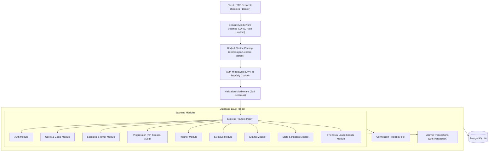
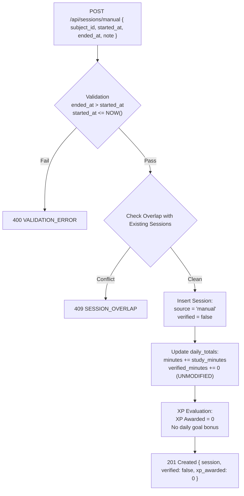
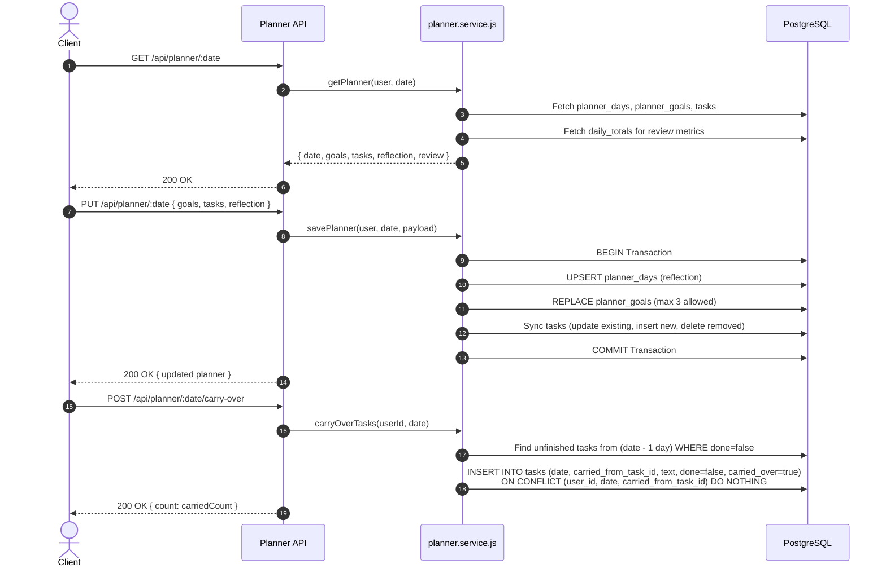
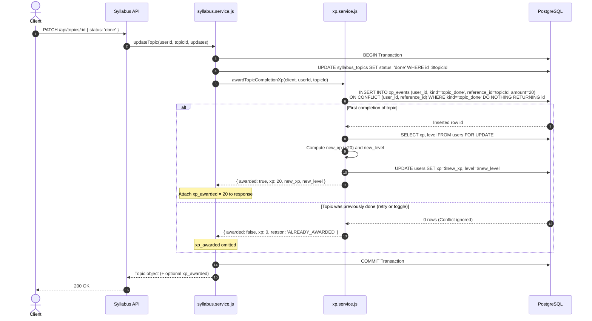
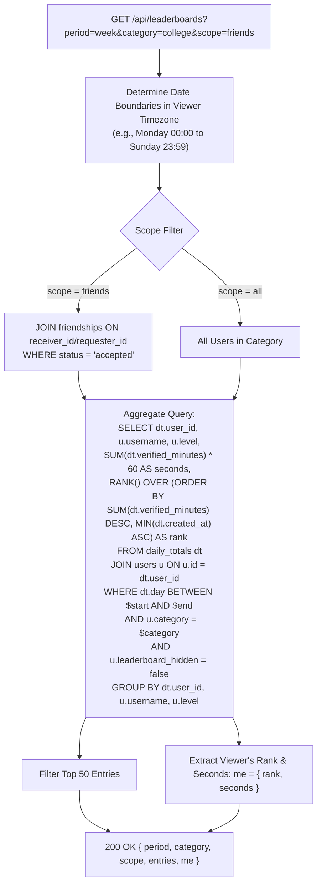
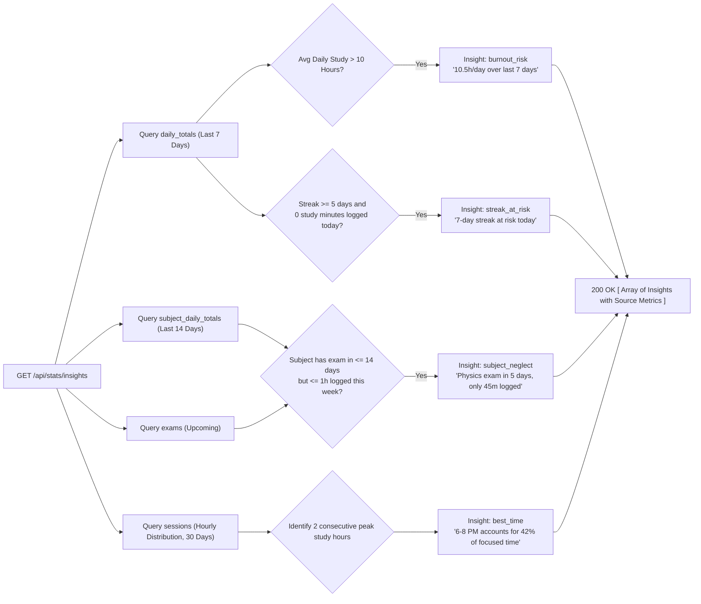
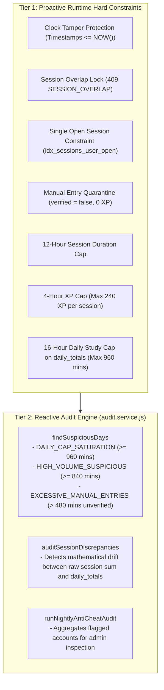

# StudyForge — Backend Architecture, APIs & Dataflow

This document provides a comprehensive technical breakdown of the **StudyForge** backend: system architecture, database design, complete REST API contracts, and end-to-end dataflows.

---

## 1. System Architecture

StudyForge is built on a modular Node.js/Express 5 architecture backed by a transactional PostgreSQL relational database.



### Architectural Principles
1. **Server Clock Authority:** Start, pause, resume, and stop timestamps are stamped by the server clock (`NOW()`). Client clocks are never trusted.
2. **Atomic Rollups:** Session finalization, streak extension, and XP awarding occur within a single database transaction (`withTransaction`) protected by row locks (`FOR UPDATE`).
3. **Time Zone-Aware Day Boundaries:** All timestamps are stored in UTC (`timestamptz`). When sessions cross midnight or roll into daily buckets, they are split according to the user's specific IANA time zone (`America/New_York`, `Asia/Kolkata`, etc.).
4. **On-Demand Dynamic Aggregation:** Leaderboards, statistics, and insights are computed on-the-fly via indexed SQL queries over `daily_totals`, ensuring immediate consistency without stale caches.
5. **Database-Level Idempotency:** Double awards, duplicate carry-overs, and concurrent timer sessions are prevented by PostgreSQL partial unique indexes.

---

## 2. Database Schema & Entity Relationships

```mermaid
erDiagram
    users ||--o{ subjects : owns
    users ||--o{ sessions : logs
    users ||--o{ daily_totals : aggregates
    users ||--o{ subject_daily_totals : aggregates
    users ||--|| streaks : tracks
    users ||--o{ xp_events : earns
    users ||--o{ planner_days : plans
    users ||--o{ planner_goals : targets
    users ||--o{ tasks : assigns
    users ||--o{ exams : schedules
    users ||--o{ friendships : requests_or_receives
    users ||--o{ blocks : blocks

    subjects ||--o{ sessions : categorizes
    subjects ||--o{ subject_daily_totals : breaks_down
    subjects ||--o{ planner_goals : aligns
    subjects ||--o{ syllabus_topics : contains
    subjects ||--o{ exams : tests

    sessions ||--o{ xp_events : generates
    tasks ||--o? tasks : carries_from
    syllabus_topics ||--o? syllabus_topics : parent_of
```

### Core Database Tables

| Table | Primary Key | Key Columns | Purpose & Constraints |
| :--- | :--- | :--- | :--- |
| **`users`** | `id UUID` | `email`, `password_hash`, `username`, `time_zone`, `category`, `privacy` (JSONB), `xp`, `level`, `daily_target_seconds`, `weekly_target_seconds`, `streak_minimum_minutes`, `leaderboard_hidden` | User profile, authentication credentials, settings, and progression totals. Case-insensitive unique indexes on `email` and `username`. |
| **`subjects`** | `id UUID` | `user_id`, `name`, `color` | User study subjects. Unique on `(user_id, name)`. Enforces hex color regex (`^#[0-9a-fA-F]{6}$`). |
| **`sessions`** | `id UUID` | `user_id`, `subject_id`, `started_at`, `ended_at`, `status`, `paused_seconds`, `break_seconds`, `study_seconds`, `note`, `source`, `verified` | Raw session ledger. Partial unique index `idx_sessions_user_open` on `(user_id) WHERE ended_at IS NULL` restricts users to at most **one** concurrent open session. |
| **`daily_totals`** | `id UUID` | `user_id`, `day`, `minutes`, `verified_minutes` | Local calendar day aggregates. Unique on `(user_id, day)`. Read model for streaks, heatmap, and leaderboards. |
| **`subject_daily_totals`**| `id UUID` | `user_id`, `subject_id`, `day`, `minutes`, `verified_minutes` | Subject-specific daily aggregates for progress graphs and subject distribution queries. |
| **`streaks`** | `user_id UUID` | `current`, `longest`, `freeze_week`, `freezes_used`, `last_counted_date` | Current and record streaks, with ISO-week tracking for automated streak freeze protection. |
| **`xp_events`** | `id UUID` | `user_id`, `session_id`, `reference_id`, `kind`, `amount`, `day` | Immutable XP ledger. Unique partial indexes enforce single awards: `idx_xp_events_session_kind`, `idx_xp_events_daily_goal`, `idx_xp_events_topic_done`. |
| **`planner_days`** | `id UUID` | `user_id`, `date`, `reflection` | Date reflection note. Unique on `(user_id, date)`. |
| **`planner_goals`** | `id UUID` | `user_id`, `date`, `subject_id`, `text`, `target_seconds` | Up to 3 goals per day. Validated at application layer. |
| **`tasks`** | `id UUID` | `user_id`, `date`, `carried_from_task_id`, `text`, `done`, `carried_over` | Daily checklist items. Unique partial index `idx_tasks_carry_over_once` prevents multiple carry-overs of the same task. |
| **`syllabus_topics`** | `id UUID` | `subject_id`, `parent_id`, `title`, `status`, `position` | Hierarchical tree of topics (`not_started`, `in_progress`, `done`). Self-referential foreign key `parent_id`. |
| **`exams`** | `id UUID` | `user_id`, `subject_id`, `date`, `target_hours` | Upcoming exams with countdown calculation. |
| **`friendships`** | `id UUID` | `requester_id`, `receiver_id`, `status` | Social graph edges (`pending`, `accepted`, `declined`). Unique on `(requester_id, receiver_id)`. |
| **`blocks`** | `id UUID` | `blocker_id`, `blocked_id` | Bidirectional privacy exclusion. Unique on `(blocker_id, blocked_id)`. |
| **`schema_migrations`** | `name TEXT` | `applied_at` | Tracks applied SQL migrations sequentially. |

---

## 3. End-to-End Backend Dataflows

### Dataflow 1: Timer Lifecycle & Atomic Session-End Transaction

This is the central engine of StudyForge. It guarantees accurate focus time, caps anti-cheat limits, awards XP, updates streaks, and splits days across midnight.

```mermaid
sequenceDiagram
    autonumber
    actor User as Client
    participant API as Sessions API
    participant Tx as session-end.transaction.js
    participant DB as PostgreSQL (Pool)

    User->>API: POST /api/sessions/start { subject_id }
    API->>DB: Check active session (idx_sessions_user_open)
    alt Already open
        DB-->>API: Conflict
        API-->>User: 409 SESSION_ALREADY_OPEN
    else No open session
        API->>DB: INSERT INTO sessions (started_at=NOW(), status='running')
        DB-->>API: Created session
        API-->>User: 201 Created { session }
    end

    opt Pause / Break / Resume
        User->>API: POST /api/sessions/:id/pause (or /break)
        API->>DB: UPDATE status='paused', segment_started_at=NOW()
        User->>API: POST /api/sessions/:id/resume
        API->>DB: Accumulate elapsed to paused_seconds/break_seconds, status='running'
    end

    User->>API: POST /api/sessions/:id/stop { note }
    API->>Tx: executeSessionEndTransaction(client, user, session, options)
    activate Tx
    Note over Tx,DB: BEGIN Transaction
    Tx->>DB: SELECT * FROM sessions WHERE id = $id FOR UPDATE
    Tx->>Tx: Calculate: total_elapsed - paused_seconds - break_seconds
    Tx->>Tx: Apply 12h max session cap
    Tx->>Tx: splitSessionAcrossDays(startedAt, endedAt, studySeconds, user.time_zone)
    
    loop For each calendar day segment
        Tx->>DB: SELECT minutes FROM daily_totals WHERE user_id=$id AND day=$seg.day FOR UPDATE
        Tx->>Tx: Enforce 16h daily cap (max 960 mins)
        Tx->>DB: UPSERT daily_totals (minutes, verified_minutes)
        Tx->>DB: UPSERT subject_daily_totals (minutes, verified_minutes)
    end

    alt Session is verified (source = 'timer')
        Tx->>Tx: calculateSessionXp (1 XP/min, capped at 240 XP)
        Tx->>DB: INSERT INTO xp_events (kind='session') ON CONFLICT DO NOTHING
        Tx->>DB: Check if daily verified target met
        opt Target met today for first time
            Tx->>DB: INSERT INTO xp_events (kind='daily_goal', amount=50) ON CONFLICT DO NOTHING
        end
        Tx->>DB: UPDATE users SET xp = new_xp, level = new_level
    end

    Tx->>Tx: updateStreakOnSessionEnd(studyMinutes >= streak_minimum_minutes)
    opt Daily threshold met
        Tx->>DB: Increment streak (or consume automated weekly freeze)
    end
    
    Note over Tx,DB: COMMIT Transaction
    deactivate Tx
    API-->>User: 200 OK { session, summary }
```



---

### Dataflow 2: Manual Session Entry & Anti-Cheat Pipeline

Manual entries allow users to backfill forgotten study blocks while strictly segregating unverified time from honest competition.



---

### Dataflow 3: Daily Planner & Task Carry-Over Pipeline



---

### Dataflow 4: Syllabus Topic Completion & Idempotent XP Hook



---

### Dataflow 5: Dynamic Leaderboard Aggregation Pipeline

Leaderboards are not static tables; they are dynamic SQL calculations that execute on-demand.



---

### Dataflow 6: Rule-Based Insights Generation Pipeline

Insights are computed deterministically when requested using pure SQL aggregates without external machine learning dependencies.



---

## 4. Complete REST API Reference

All routes are mounted under the `/api` prefix. Standard error responses adhere to the format:
```json
{
  "error": {
    "code": "ERROR_CODE",
    "message": "Human readable error description",
    "fields": { "fieldName": "Field specific message" }
  }
}
```

### 4.1. Authentication Module (`/api/auth`)

| Method & Route | Auth Required | Request Body | Success Response | Error Codes |
| :--- | :---: | :--- | :--- | :--- |
| `POST /api/auth/register` | No | `{ email, username, password, category?, time_zone? }` | `201 Created` with User object + `Set-Cookie: token` | `400 VALIDATION_ERROR`<br>`409 EMAIL_TAKEN`<br>`409 USERNAME_TAKEN` |
| `POST /api/auth/login` | No (Rate limited: 6/min) | `{ email, password }` | `200 OK` with User object + `Set-Cookie: token` | `401 INVALID_CREDENTIALS`<br>`429 RATE_LIMITED` |
| `POST /api/auth/logout` | No | None | `200 OK` `{ ok: true }` + clears cookie | None |

---

### 4.2. Users & Progression Module (`/api/me`)

| Method & Route | Auth Required | Request Parameters / Body | Success Response | Error Codes |
| :--- | :---: | :--- | :--- | :--- |
| `GET /api/me` | Yes | None | `200 OK` Full user profile object | `401 UNAUTHORIZED` |
| `PATCH /api/me` | Yes | `{ username?, time_zone?, category?, leaderboard_hidden?, privacy?, streak_minimum_minutes? }` | `200 OK` Updated user profile object | `400 VALIDATION_ERROR`<br>`409 USERNAME_TAKEN` |
| `GET /api/me/xp` | Yes | None | `200 OK` `{ xp, level, xp_in_level, xp_for_next_level }` | `401 UNAUTHORIZED` |
| `GET /api/me/xp/events` | Yes | Query: `?limit=50&cursor=...` | `200 OK` `{ items: [...], next_cursor }` | `400 VALIDATION_ERROR` |
| `GET /api/me/streak` | Yes | None | `200 OK` `{ current, longest, freeze_available, freezes_used, today_minutes, minimum_minutes }` | `401 UNAUTHORIZED` |
| `GET /api/me/goals` | Yes | None | `200 OK` `{ daily_target_seconds, weekly_target_seconds, streak_minimum_minutes, today_seconds, week_seconds, days: [...] }` | `401 UNAUTHORIZED` |
| `PUT /api/me/goals` | Yes | `{ daily_target_seconds?, weekly_target_seconds?, streak_minimum_minutes? }` | `200 OK` Updated goals object with progress | `400 VALIDATION_ERROR` |
| `GET /api/me/goals/weekly`| Yes | None | `200 OK` `{ week_start, week_end, weekly_target_seconds, week_seconds, week_progress_percent, days_goal_met, weekly_goal_met, days: [...] }` | `401 UNAUTHORIZED` |
| `GET /api/me/export.csv` | Yes | None | `200 OK` `Content-Type: text/csv` (Streams all user study sessions) | `401 UNAUTHORIZED` |
| `DELETE /api/me` | Yes | None | `200 OK` `{ ok: true }` (Cascades all user rows) | `401 UNAUTHORIZED` |

---

### 4.3. Subjects Module (`/api/subjects`)

| Method & Route | Auth Required | Request Body | Success Response | Error Codes |
| :--- | :---: | :--- | :--- | :--- |
| `GET /api/subjects` | Yes | None | `200 OK` `[ { id, name, color, created_at }, ... ]` | `401 UNAUTHORIZED` |
| `POST /api/subjects` | Yes | `{ name, color }` (`color` must match `^#[0-9a-fA-F]{6}$`) | `201 Created` Subject object | `400 VALIDATION_ERROR`<br>`409 SUBJECT_NAME_TAKEN` |
| `PATCH /api/subjects/:id`| Yes | `{ name?, color? }` | `200 OK` Updated subject object | `404 NOT_FOUND`<br>`409 SUBJECT_NAME_TAKEN` |
| `DELETE /api/subjects/:id`| Yes | None | `200 OK` `{ ok: true }` (Cascades topics, totals, exams) | `404 NOT_FOUND` |

---

### 4.4. Sessions & Timer Module (`/api/sessions`)

| Method & Route | Auth Required | Request Body / Query | Success Response | Error Codes |
| :--- | :---: | :--- | :--- | :--- |
| `POST /api/sessions/start` | Yes | `{ subject_id }` | `201 Created` Session object | `404 NOT_FOUND`<br>`409 SESSION_ALREADY_OPEN` |
| `GET /api/sessions/active` | Yes | None | `200 OK` `{ session }` or `{ session: null }` | `401 UNAUTHORIZED` |
| `POST /api/sessions/:id/pause` | Yes | None | `200 OK` Updated session (`status='paused'`) | `409 INVALID_STATE` |
| `POST /api/sessions/:id/break` | Yes | None | `200 OK` Updated session (`status='on_break'`) | `409 INVALID_STATE` |
| `POST /api/sessions/:id/resume`| Yes | None | `200 OK` Updated session (`status='running'`) | `409 INVALID_STATE` |
| `POST /api/sessions/:id/stop` | Yes | `{ note? }` | `200 OK` `{ session, summary: { study_seconds, counted_seconds, verified, xp_awarded, session_xp, bonus_xp, daily_goal_met, streak, today_seconds } }` | `404 NOT_FOUND`<br>`409 INVALID_STATE` |
| `POST /api/sessions/manual` | Yes | `{ subject_id, started_at, ended_at, note? }` | `201 Created` Session object (`verified: false`, 0 XP) | `400 VALIDATION_ERROR`<br>`409 SESSION_OVERLAP` |
| `GET /api/sessions` | Yes | Query: `?from=&to=&q=&subject_id=&limit=&cursor=` | `200 OK` `{ items: [...], next_cursor }` | `400 VALIDATION_ERROR` |
| `DELETE /api/sessions/:id` | Yes | None | `200 OK` `{ ok: true }` | `404 NOT_FOUND` |

---

### 4.5. Daily Planner Module (`/api/planner`)

| Method & Route | Auth Required | Request Body | Success Response | Error Codes |
| :--- | :---: | :--- | :--- | :--- |
| `GET /api/planner/:date` | Yes | None | `200 OK` `{ date, goals: [...], tasks: [...], reflection, review: { total_seconds, goals_met, goals_total, tasks_done, tasks_total } }` | `400 VALIDATION_ERROR` |
| `PUT /api/planner/:date` | Yes | `{ goals: [max 3], tasks: [...], reflection? }` | `200 OK` Full updated planner day object | `400 GOAL_LIMIT_REACHED`<br>`400 VALIDATION_ERROR` |
| `POST /api/planner/:date/carry-over` | Yes | None | `200 OK` `{ count: number }` (Carries unfinished tasks from date - 1) | `400 VALIDATION_ERROR` |

---

### 4.6. Syllabus Module (`/api`)

| Method & Route | Auth Required | Request Body | Success Response | Error Codes |
| :--- | :---: | :--- | :--- | :--- |
| `GET /api/subjects/:id/syllabus` | Yes | None | `200 OK` `{ topics: [Tree with children], counts: { not_started, in_progress, done, total } }` | `404 NOT_FOUND` |
| `POST /api/topics` | Yes | `{ subject_id, parent_id?, title, position? }` | `201 Created` Topic object | `400 VALIDATION_ERROR`<br>`404 NOT_FOUND` |
| `PATCH /api/topics/:id` | Yes | `{ title?, status?, parent_id?, position? }` | `200 OK` Topic object (`+ xp_awarded: 20` on first completion to `done`) | `400 VALIDATION_ERROR`<br>`404 NOT_FOUND` |
| `DELETE /api/topics/:id` | Yes | None | `200 OK` `{ ok: true }` (Cascades child subtopics) | `404 NOT_FOUND` |
| `POST /api/subjects/:id/syllabus/import` | Yes | `{ text }` (Tab or 2-space indented list) | `201 Created` `{ created_count: number }` | `400 VALIDATION_ERROR` |

---

### 4.7. Exams Module (`/api/exams`)

| Method & Route | Auth Required | Request Body | Success Response | Error Codes |
| :--- | :---: | :--- | :--- | :--- |
| `GET /api/exams` | Yes | None | `200 OK` `[ { id, subject_id, date, target_hours, days_left, hours_needed_per_day }, ... ]` | `401 UNAUTHORIZED` |
| `POST /api/exams` | Yes | `{ subject_id, date, target_hours? }` | `201 Created` Exam object with `days_left` | `400 VALIDATION_ERROR`<br>`404 NOT_FOUND` |
| `PATCH /api/exams/:id` | Yes | `{ date?, target_hours? }` | `200 OK` Updated exam object | `400 VALIDATION_ERROR`<br>`404 NOT_FOUND` |
| `DELETE /api/exams/:id` | Yes | None | `200 OK` `{ ok: true }` | `404 NOT_FOUND` |

---

### 4.8. Statistics & Insights Module (`/api/stats`)

| Method & Route | Auth Required | Query Parameters | Success Response | Error Codes |
| :--- | :---: | :--- | :--- | :--- |
| `GET /api/stats/heatmap` | Yes | `?year=YYYY` (Defaults to current year) | `200 OK` `{ year, max_seconds, days: [ { date, seconds }, ... ] }` | `400 VALIDATION_ERROR` |
| `GET /api/stats/progress` | Yes | `?range=week\|month` | `200 OK` `{ range, total_seconds, daily_average_seconds, points: [ { label, seconds }, ... ] }` | `400 VALIDATION_ERROR` |
| `GET /api/stats/subjects` | Yes | `?range=week\|month` | `200 OK` `{ range, total_seconds, subjects: [ { id, name, color, seconds, percentage }, ... ] }` | `400 VALIDATION_ERROR` |
| `GET /api/stats/insights` | Yes | None | `200 OK` `[ { id, type, title, message, metrics: {} }, ... ]` | `401 UNAUTHORIZED` |

---

### 4.9. Friends & Leaderboards Module (Phase 3 Specification)

| Method & Route | Auth Required | Request Body / Query | Success Response | Error Codes |
| :--- | :---: | :--- | :--- | :--- |
| `POST /api/friends/requests` | Yes (Rate limited: 15/15m) | `{ username }` | `201 Created` Request object | `404 NOT_FOUND` (If user blocked or doesn't exist)<br>`409 ALREADY_FRIENDS`<br>`429 RATE_LIMITED` |
| `GET /api/friends/requests` | Yes | None | `200 OK` `{ incoming: [...], outgoing: [...] }` | `401 UNAUTHORIZED` |
| `PATCH /api/friends/requests/:id` | Yes | `{ action: "accept" \| "decline" }` | `200 OK` `{ ok: true }` | `403 FORBIDDEN` (Only receiver can act)<br>`404 NOT_FOUND` |
| `GET /api/friends` | Yes | None | `200 OK` `{ items: [ { user_id, username, level, streak_current, week_seconds }, ... ] }` *(week_seconds null if privacy set to nobody)* | `401 UNAUTHORIZED` |
| `DELETE /api/friends/:id` | Yes | None | `200 OK` `{ ok: true }` | `404 NOT_FOUND` |
| `POST /api/blocks` | Yes | `{ user_id }` | `201 Created` `{ ok: true }` (Breaks friendship & blocks visibility) | `400 VALIDATION_ERROR` |
| `DELETE /api/blocks/:userId` | Yes | None | `200 OK` `{ ok: true }` | `404 NOT_FOUND` |
| `GET /api/leaderboards` | Yes | `?period=day\|week\|month&category=...&scope=all\|friends` | `200 OK` `{ period, category, scope, period_start, period_end, entries: [ { rank, user_id, username, level, seconds }, ... ], me: { rank, seconds } }` | `400 VALIDATION_ERROR` |

---

## 5. Anti-Cheat Engine & Security

StudyForge uses a two-tier anti-cheat architecture:



### Leaderboard Integrity
Because leaderboards query `WHERE verified_minutes > 0` over `daily_totals`:
- Unverified manual entries **never** reach leaderboards.
- Disqualifying an invalid session immediately deducts its minutes from `daily_totals.verified_minutes`, causing rankings to update automatically on the very next query with **zero cache lag**.

