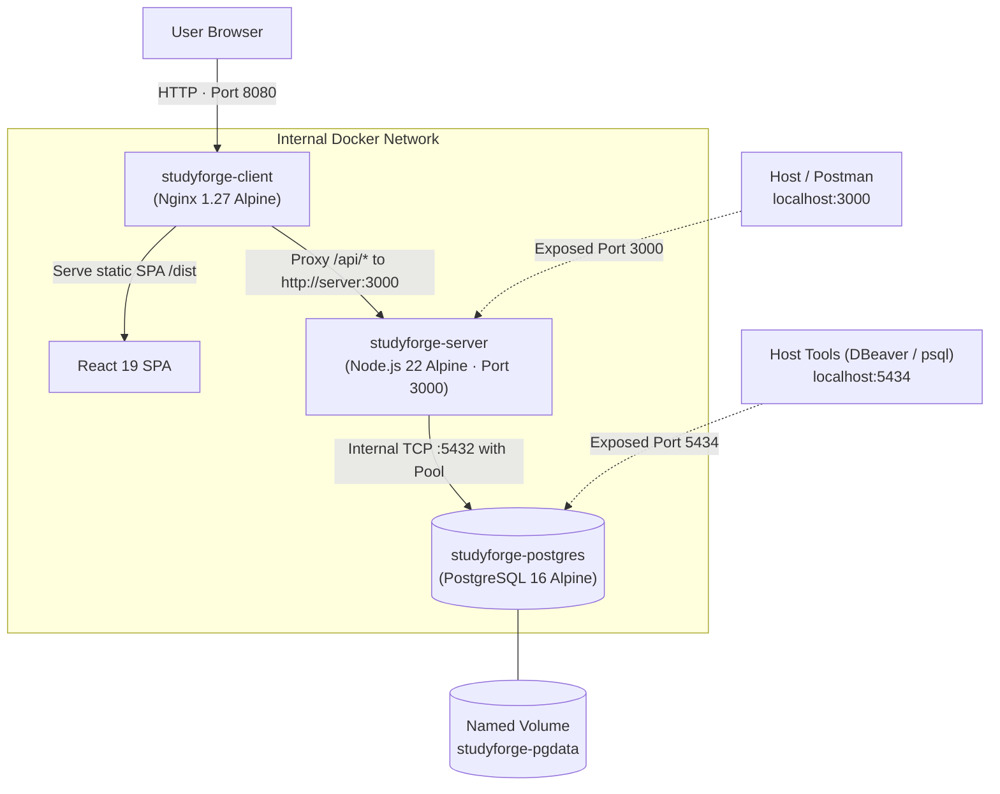

# StudyForge — Complete Dockerization Guide

This guide provides end-to-end instructions for running the complete **StudyForge** stack (React Frontend, Express Backend, and PostgreSQL Database) inside isolated, production-grade Docker containers.

---

## 1. System Topology & Architecture

When running the containerized stack, all three tiers run as separate lightweight containers communicating over an internal Docker bridge network (`studyforge-network`):



### Exposed Host Ports:
- **`http://localhost:8080`**: Client Web Application (served by Nginx with API reverse proxy)
- **`http://localhost:3000`**: Direct Express 5 REST API endpoint (healthcheck: `http://localhost:3000/healthz`)
- **`localhost:5434`**: Direct PostgreSQL 16 connection for host tools (e.g., TablePlus, DBeaver, psql)

---

## 2. Quickstart (One-Command Launch)

### Prerequisites:
- **Docker Desktop** (Mac/Windows) or **Docker Engine 24+ & Docker Compose v2+** (Linux)
- At least 2 GB of free RAM allocated to Docker

### Launch the Entire Stack:
From the root of the repository, execute:

```bash
# Using the root npm helper script:
npm run docker:full:up

# Or using docker compose directly:
docker compose -f docker-compose.full.yml up --build -d
```

### What happens automatically:
1. Spawns `postgres:16-alpine` and waits for the database healthcheck to pass.
2. Builds the Express backend, connects to PostgreSQL, and automatically runs `schema.sql` and all pending migrations via `AUTO_INIT_DB="true"`.
3. Multi-stage builds the Vite + React frontend into optimized static assets and boots an Nginx Alpine container.
4. Binds ports `8080` (Client), `3000` (API), and `5434` (Database).

### Verify Status:
```bash
docker compose -f docker-compose.full.yml ps
```

You should see all 3 containers in `healthy` or `running` state:
```text
NAME                  IMAGE                COMMAND                  SERVICE   STATUS
studyforge-postgres   postgres:16-alpine   "docker-entrypoint.s…"   db        Up (healthy)
studyforge-server     studyforge-server    "node src/server.js"     server    Up (healthy)
studyforge-client     studyforge-client    "nginx -g 'daemon of…"   client    Up (healthy)
```

Now open **`http://localhost:8080`** in your browser!

### Stop the Stack:
```bash
# Stop containers (preserves database data)
npm run docker:full:down
# or: docker compose -f docker-compose.full.yml down
```

---

## 3. Container Breakdown

### A. Frontend Container (`client/Dockerfile`)
The frontend uses a **multi-stage build** to maximize performance and minimize final image size (~25 MB):
1. **Stage 1 (Builder):** Uses `node:lts-alpine` with `apk upgrade` to install dependencies via `npm ci` and compile production assets (`npm run build`).
2. **Stage 2 (Runner):** Uses `nginx:alpine-slim` with `apk update && apk upgrade --no-cache` to patch OS-level CVEs and strip unused modules (njs, xslt, geoip), serving static files in an ultra-lean runtime. It includes a custom [`client/nginx.conf`](../client/nginx.conf) with:
   - **SPA Fallback:** `try_files $uri $uri/ /index.html` ensuring client-side navigation and browser refreshes work seamlessly.
   - **Zero-CORS API Proxy:** Rewrites all `/api/` traffic directly to `http://server:3000`, so authentication cookies are transmitted as first-party cookies without cross-origin issues.
   - **Gzip Compression:** Automatically compresses text, CSS, JS, JSON, and SVG assets.
   - **Static Asset Caching:** 1-year immutable caching headers for versioned Vite assets.

### B. Backend Container (`server/Dockerfile`)
- Uses `node:lts-alpine` with `apk upgrade` for an updated, minimal, and secure Node.js runtime.
- Installs production-only dependencies using `npm ci --omit=dev`.
- Runs as the unprivileged `node` user (non-root) to prevent container escape vulnerabilities.
- Includes container healthcheck via `wget http://localhost:3000/healthz`.

### C. Database Container (`postgres:16-alpine`)
- Stores persistent data in a Docker named volume (`studyforge-pgdata`).
- Includes a healthcheck (`pg_isready -U postgres -d tracker`) to ensure the backend only starts once the database is fully accepting queries.

---

## 4. Configuration & Environment Variables

You can customize runtime behavior by setting environment variables in a root `.env` file or directly in `docker-compose.full.yml`:

| Variable | Default in Compose | Purpose |
| :--- | :--- | :--- |
| `POSTGRES_USER` | `postgres` | PostgreSQL username |
| `POSTGRES_PASSWORD` | `postgres` | PostgreSQL password |
| `POSTGRES_DB` | `tracker` | Database name |
| `DB_PORT` | `5434` | Host port exposed for PostgreSQL |
| `JWT_SECRET` | *(32+ char secret)* | Secret key used to sign session JWTs |
| `JWT_EXPIRES_IN` | `7d` | Lifetime of authentication cookie |
| `AUTO_INIT_DB` | `true` | Runs `schema.sql` and `migrations/` automatically on startup |
| `DAILY_CAP_HOURS` | `16` | Anti-cheat maximum study hours allowed per day |
| `MAX_SESSION_HOURS`| `12` | Anti-cheat single session duration cap |
| `SESSION_XP_CAP_HOURS`| `4` | Maximum hours rewarded with XP per session (240 XP) |

---

## 5. Database Management in Docker

### View Live Database Logs:
```bash
docker compose -f docker-compose.full.yml logs -f db
```

### Access PostgreSQL Interactive Shell (`psql`):
```bash
docker compose -f docker-compose.full.yml exec db psql -U postgres -d tracker
```

### Backup the Database (Dump to SQL):
```bash
docker compose -f docker-compose.full.yml exec -T db pg_dump -U postgres tracker > backup_$(date +%Y%m%d).sql
```

### Restore the Database from SQL:
```bash
docker compose -f docker-compose.full.yml exec -T db psql -U postgres tracker < backup_20261024.sql
```

### Wipe and Rebuild Database from Scratch:
> [!CAUTION]
> This destroys all existing local database data in the Docker volume.
```bash
docker compose -f docker-compose.full.yml down -v
docker compose -f docker-compose.full.yml up --build -d
```

---

## 6. Running Tests Inside Docker

You can run the full Vitest suite (124 tests across 19 files) directly inside the running server container:

```bash
docker compose -f docker-compose.full.yml exec server npm test
```

---

## 7. Production Deployment to a VPS

To deploy this containerized setup to a cloud VPS (e.g., DigitalOcean Droplet, AWS EC2, Linode, or Hetzner):

1. **Install Docker & Docker Compose** on your remote server:
   ```bash
   curl -fsSL https://get.docker.com | sh
   ```
2. **Clone the repository:**
   ```bash
   git clone https://github.com/adityapraja/StudyForge.git
   cd StudyForge
   ```
3. **Create a production `.env` with strong secrets:**
   ```bash
   # Generate a 32-character random string for JWT_SECRET
   openssl rand -hex 32
   ```
4. **Change host port in `docker-compose.full.yml`:**
   Change the client port from `8080:80` to `80:80` (and `443:443` if terminating SSL with Let's Encrypt / Certbot).
5. **Start services:**
   ```bash
   docker compose -f docker-compose.full.yml up --build -d
   ```

---

## 8. Troubleshooting & FAQ

### Port `8080`, `3000`, or `5434` already in use:
If another process is using one of the ports:
- Change the host port mapping in `docker-compose.full.yml` (e.g., change `"8080:80"` to `"8081:80"`).
- Or kill the process currently binding the port:
  ```bash
  sudo lsof -i :8080
  ```

### Server fails to connect to database:
Ensure the `depends_on` condition is satisfied. The server container waits for `db` to be `service_healthy`. If the database fails to initialize:
```bash
docker compose -f docker-compose.full.yml logs db
```

### Rebuilding after code changes:
Whenever you modify backend or frontend code, force Docker to rebuild the images:
```bash
docker compose -f docker-compose.full.yml up --build -d
```

